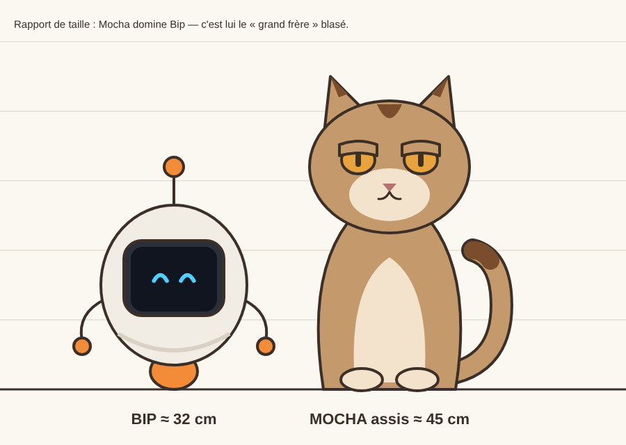
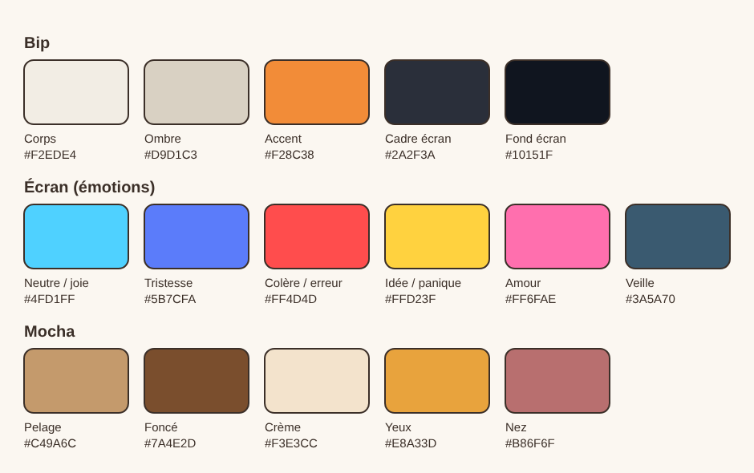
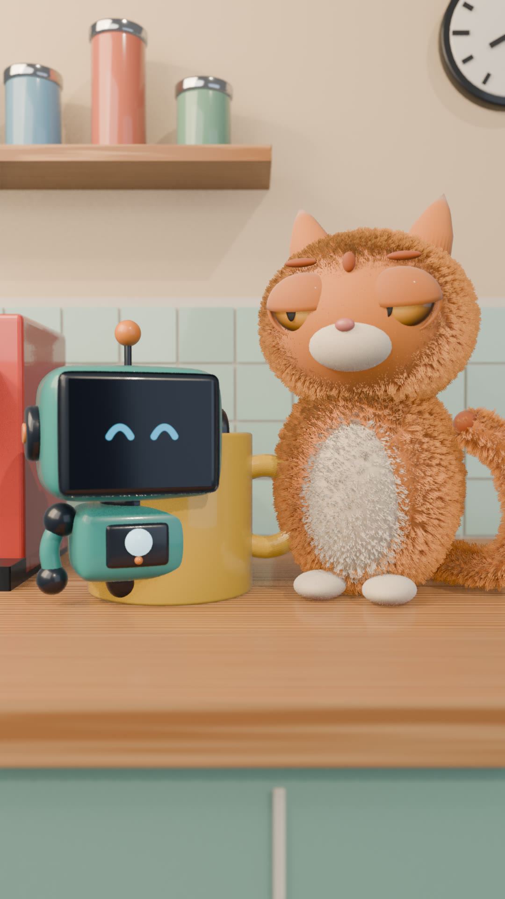
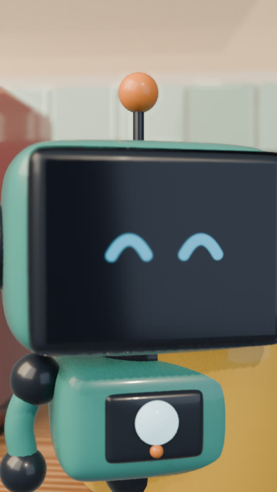
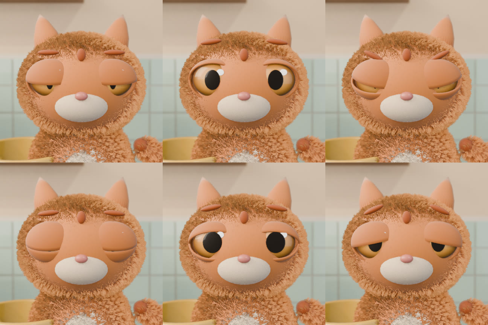
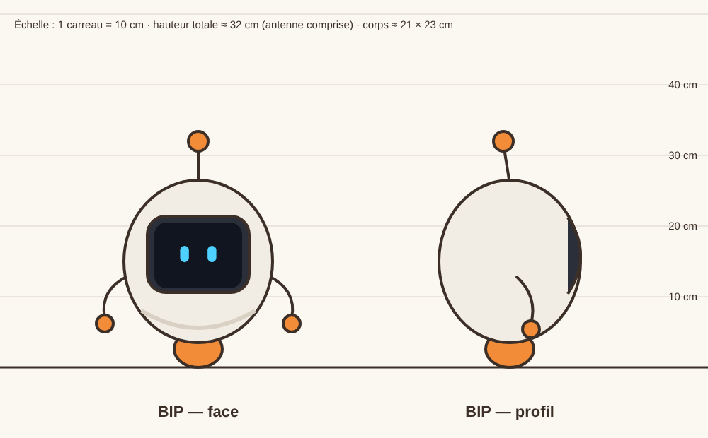
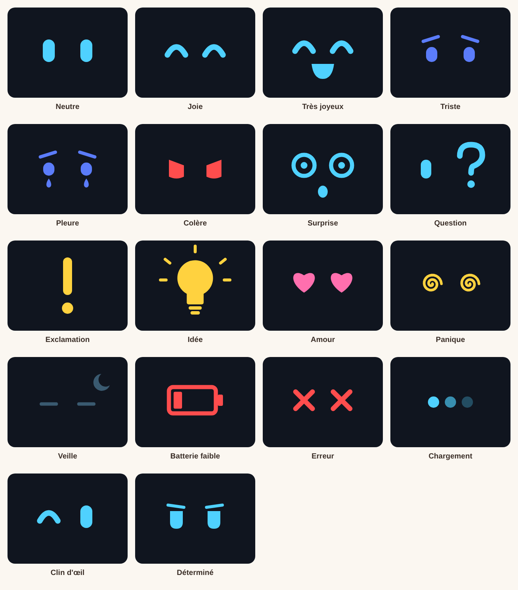
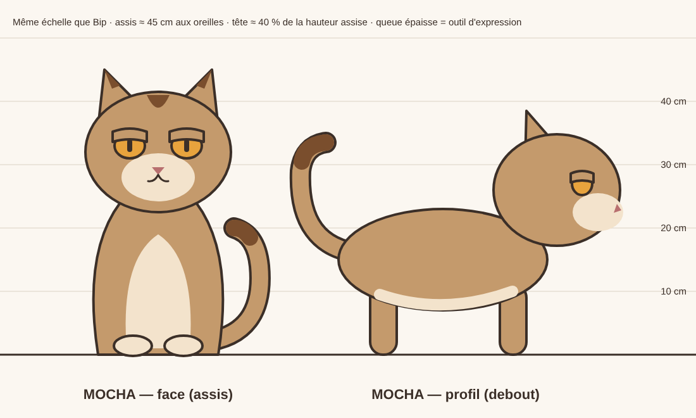
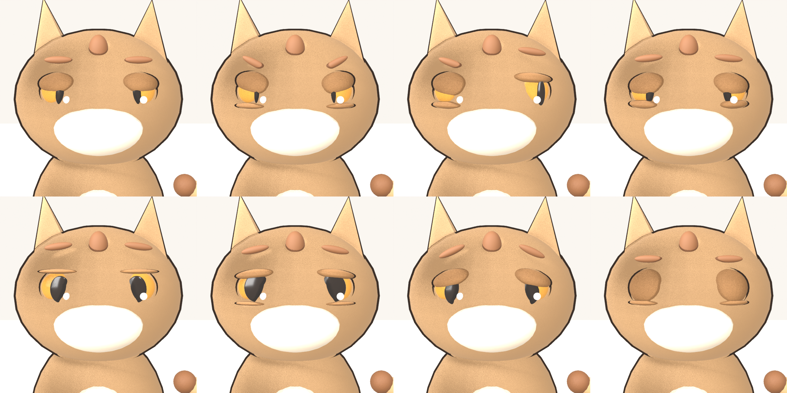

# 8. Fiches personnages

Référence officielle pour modéliser Bip et Mocha dans Blender (semaines 1 et 2 du
[plan de préparation](06-plan-lancement.md#phase-0--préparation-6-semaines-2-hjour)).

Tous les visuels sont dans [`assets/design/`](../assets/design/) et se régénèrent avec
`node tools/generer-design.js` (pour changer une couleur, modifier `PALETTE` dans le script).

| Visuel | Fichier |
|---|---|
| Rapport de taille |  |
| Palette |  |

---

## 🎬 Style « studio » (le look officiel de la série depuis novembre 2026)

Rendu doux et brillant façon film d'animation 3D : matières laquées, vrai pelage, grands yeux,
lumière de fenêtre et arrière-plan légèrement flou. Tout est dans
[`tools/blender/style-studio.py`](../tools/blender/style-studio.py), appliqué automatiquement par
`preparer-scene.py` et `decor-cuisine.py` (les scripts d'épisode n'ont rien à changer).

| Bip et Mocha dans la cuisine | Bip (gros plan) |
|---|---|
|  |  |


*Yeux de Mocha : mi-clos (son air habituel), ouverts, agacé / content, attendri, triste.*

**Bip v2** — robot en plastique laqué bleu-vert (`#3FA19D`) : grosse tête-écran arrondie posée sur
un petit corps, oreilles rondes bleu nuit à point orange, antenne à boule orange, voyant lumineux
sur la poitrine, bras articulés (épaule et main bleu nuit, bracelet orange), petite roue.
L'écran garde les 18 expressions (avec un reflet de vitre).

**Mocha v2** — vrai pelage orange (poils plus foncés à la racine, pointes dorées), ventre crème, visage
dégagé, grands yeux ambrés vernis (×1,55), paupières en « coques » qui épousent l'œil, nez rose,
oreilles douces à intérieur rose, queue touffue.

**Image** — rendu AgX « Punchy », reflets et lumière indirecte en lancer de rayons (EEVEE),
profondeur de champ automatique (la mise au point suit la cible de la caméra).

**Temps de rendu** — ≈ 50 s par image en 1080 × 1920 sur le serveur (processeur seul) : un épisode
se calcule donc sur un PC avec carte graphique (voir [doc 10](10-rendu-sur-pc.md)).
L'ancien style « blockout » reste disponible : `STYLE = "simple"` avant `preparer-scene.py`.

---

## 🤖 BIP



### Identité
| | |
|---|---|
| Taille | **≈ 32 cm** antenne comprise (une bouilloire) |
| Silhouette | Un **œuf** légèrement plus haut que large (21 × 23 cm), une antenne, deux petits bras |
| Visage | Un **écran** 4:3 encastré à l'avant : toutes ses émotions passent par là |
| Déplacement | **Une boule-roue** sous le corps (pas de jambes) |
| Matière | Plastique crème mat, légèrement brillant · accents orange |
| Son | Bips, grésillements, « boup » — jamais de mots |

### Pourquoi ces choix (gain de temps en solo)
- **Pas de jambes → pas de cycle de marche à animer.** Bip roule, glisse, dérape, bascule :
  c'est plus drôle et beaucoup plus rapide à animer.
- **Écran au lieu d'un visage → pas d'animation faciale.** On change une image, c'est tout.
- **Silhouette ultra simple** → reconnaissable même en vignette sur un téléphone, et facile
  à refaire si on retouche le modèle.
- **L'antenne** est un outil d'expression gratuit : elle se dresse (alerte), tombe (tristesse),
  vibre (panique), et sa boule peut s'allumer de la couleur de l'émotion.

### Modélisation dans Blender (ordre conseillé)
1. **Corps** : UV Sphere → mise à l'échelle Z ×1,1 → Subdivision Surface niveau 2.
2. **Écran** : sur l'avant du corps, extruder une zone rectangulaire vers l'intérieur
   (cadre `#2A2F3A`), puis un plan légèrement bombé pour la vitre.
3. **Matériau de l'écran** : `Image Texture` → `Emission` (force 2–4). Le fichier image
   change selon l'émotion (voir ci-dessous).
4. **Antenne** : cylindre fin + sphère (matériau orange `#F28C38`, émission optionnelle).
5. **Bras** : courbe (Bezier) avec épaisseur, ou cylindre avec 4–5 os → mains = petites sphères orange.
6. **Roue** : sphère orange à moitié cachée sous le corps.
7. **Rig** : très simple — os racine, corps, antenne (2 os), chaque bras (3 os), roue.
   Pas besoin de Rigify pour Bip.
8. **Rendu** : EEVEE, contour avec *Line Art* ou *Freestyle* (trait `#3B2F28`) pour le style cartoon.

### Les 18 expressions de l'écran
Fichiers prêts à l'emploi (PNG 640 × 480) dans [`assets/design/bip-ecran/`](../assets/design/bip-ecran/).



| Expression | Fichier | Quand l'utiliser |
|---|---|---|
| Neutre | `neutre.png` | État par défaut |
| Joie | `joie.png` | Content, fier |
| Très joyeux | `tres-joyeux.png` | Euphorie, réussite |
| Triste | `triste.png` | Déçu, échec |
| Pleure | `pleure.png` | Gros chagrin, épisodes « émotion » |
| Colère | `colere.png` | Fâché, vexé |
| Surprise | `surprise.png` | Étonné, choc |
| Question | `question.png` | Ne comprend pas |
| Exclamation | `exclamation.png` | Alerte, découverte |
| Idée | `idee.png` | Eurêka |
| Amour | `amour.png` | Tendresse pour Mocha |
| Panique | `panique.png` | Catastrophe en cours |
| Veille | `veille.png` | Dort, économie d'énergie |
| Batterie faible | `batterie-faible.png` | Doit se recharger (épisode 4) |
| Erreur | `erreur.png` | Assommé, bug |
| Chargement | `chargement.png` | Réfléchit, attend |
| Clin d'œil | `clin-oeil.png` | Complice, malin |
| Déterminé | `determine.png` | Passe à l'action |

**Astuce Blender pour changer d'expression** : charger toutes les images, puis utiliser
un nœud `Image Texture` en mode **Image Sequence** (renommer les fichiers `0001.png`,
`0002.png`…) et animer le décalage d'image (*Offset*) avec des images clés « constantes ».
Alternative plus simple : un nœud `Mix` entre deux textures, animé par une propriété.

**Règle d'animation** : chaque changement d'expression = un **micro-clignotement** (2 images
d'écran noir) + un petit « bip » → ça rend Bip vivant pour presque rien.

---

## 🐱 MOCHA



### Identité
| | |
|---|---|
| Taille | **≈ 45 cm assis** (aux oreilles), plus grand que Bip |
| Silhouette | **Rond et trapu** : grosse tête (≈ 40 % de la hauteur assise), pattes courtes, queue épaisse |
| Pelage | Café au lait `#C49A6C`, ventre et museau crème `#F3E3CC` |
| Marques | Bout de la queue, pointe des oreilles et **une « goutte » sur le front** couleur moka `#7A4E2D` (signature visuelle) |
| Yeux | Ambre `#E8A33D`, pupilles verticales, **paupières mi-closes par défaut** (blasé) |
| Bouche | Invisible au repos — n'apparaît que pour bâiller ou miauler (donc les rares miaous comptent) |
| Son | Soupirs, ronronnements, miaous très rares |

### Pourquoi ces choix
- **Pas de poils simulés** : aplats de couleur + léger dégradé → rendu rapide, style cohérent avec Bip.
- **Paupières mi-closes** = toute la personnalité de Mocha en une forme. Le regard caméra
  blasé est la « signature » des épisodes.
- **Queue épaisse** = deuxième visage : elle dit l'humeur quand Mocha ne bouge pas.

### Langage corporel (aide-mémoire pour l'animation)
| Émotion | Yeux | Oreilles | Queue |
|---|---|---|---|
| Blasé (défaut) | Mi-clos | Droites | Posée, bout qui bouge parfois |
| Content | Fermés, plissés | Droites | Dressée, bout en crochet |
| Agacé | Mi-clos, fixes | Légèrement tournées | Fouette d'un côté à l'autre |
| Méfiant | Plissés | En arrière | Basse, rigide |
| Surpris / peur | Grands ouverts, pupilles rondes | Plaquées | Gonflée ×2 (*shape key*) |
| Curieux | Ouverts | En avant | Dressée en point d'interrogation |
| Sommeil | Fermés | Détendues | Enroulée autour du corps |

### Les yeux de Mocha (8 expressions prêtes à l'emploi)


De gauche à droite et de haut en bas : `mi-clos` (blasé, défaut) · `agace` · `mefiant` · `content` ·
`ouverts` (surpris) · `attendri` · `triste` · `fermes`.

L'œil est fait de 6 pièces, chacune avec un rôle :
| Pièce | Rôle dans l'émotion |
|---|---|
| **Paupière haute** (`Mocha_Paupiere_G/D`) | Ouverture de l'œil + **inclinaison** : coin intérieur bas = colère, coin intérieur haut = tristesse |
| **Paupière basse** (`Mocha_Paupiere_Bas_G/D`) | Regard plissé : satisfait, mesquin, agacé |
| **Pupille** (`Mocha_Pupille_G/D`) | Fente fine = agacé / méfiant · ronde et grande = surpris / attendri (comme un vrai chat) |
| **Regard** (`Mocha_Regard_G/D`) | Où il regarde : Bip, le bouton, la caméra… **le regard raconte le gag** |
| **Reflet** (`Mocha_Reflet_G/D`) | Le point de lumière qui rend le regard vivant (disparaît quand l'œil est fermé) |
| **Sourcil** (`Mocha_Sourcil_G/D`) | Petite touffe plus foncée : hauteur + inclinaison, renforce chaque émotion |

Dans un script d'épisode :
```python
A.yeux_mocha(120, "mefiant", regard=(-0.8, 0))   # à l'image 120, méfiant, regarde vers la gauche (Bip)
A.yeux_mocha(150, "content", cote="D")           # un seul œil
```
Règle d'or : **Mocha reste blasé (`mi-clos`) la plupart du temps**. Les autres expressions sont des
« pics » courts, ce qui les rend plus drôles. Toutes les valeurs sont dans `YEUX_MOCHA`
(`tools/blender/outils_animation.py`) : faciles à ajuster ou à compléter.

### Modélisation dans Blender
1. **Ne pas partir de zéro** : générer une base avec un outil image → 3D à partir de l'image
   de référence (voir prompts ci-dessous), puis **simplifier** et **retopologiser** dans Blender
   (viser < 10 000 faces).
2. **Formes** : tête quasi sphérique, corps en goutte, pattes en cylindres arrondis, queue = courbe épaisse.
3. **Yeux** : sphères séparées + paupières haute et basse, pupille, reflet et sourcil (voir « Les yeux
   de Mocha » ci-dessus). Garder les **mêmes noms d'objets** pour que les animations existantes s'appliquent.
4. **Rig** : Rigify propose un modèle de quadrupède (*Cat* dans les métarigs animaux à activer)
   — c'est la partie la plus technique, prévoir du temps en semaine 2.
5. **Queue** : chaîne de 6–8 os + contrainte *Spline IK* → très facile à animer.
6. **Shape keys utiles** : bâillement, oreilles plaquées, queue gonflée, joues gonflées (boude).

---

## 🎨 Prompts pour les images de référence (IA)

À utiliser dans un générateur d'images pour **explorer le style** puis produire une image
« propre » à envoyer dans un outil image → 3D. Les prompts sont en anglais (les outils
le comprennent mieux). Ne jamais publier ces images telles quelles : ce sont des références.

### Bip — exploration du style
```
Cute small household robot character, egg-shaped glossy cream-white body,
a rectangular dark screen as its face showing two simple glowing cyan eyes,
a thin antenna with an orange ball on top, two short noodle arms with small
orange ball hands, moves on a single orange ball wheel instead of legs,
stylized 3D cartoon, soft rounded shapes, clean simple design, warm cozy lighting,
plain light background, full body, character design sheet
```

### Bip — image pour l'outil image → 3D
```
Front view of a cute egg-shaped robot, cream-white body, dark rectangular screen
face, thin antenna with orange ball, short arms held slightly away from the body,
single orange ball wheel underneath, stylized 3D toy render, neutral even lighting,
no shadows, centered, plain white background, full body visible
```

### Mocha — exploration du style
```
Chubby round café-au-lait colored cat character, cream belly and muzzle,
darker mocha brown tail tip, ear tips and a small drop-shaped mark on the forehead,
big round head, short legs, thick expressive tail, amber eyes with half-closed
unimpressed eyelids, stylized 3D cartoon, simple shapes, no realistic fur,
warm cozy lighting, plain light background, character design sheet
```

### Mocha — image pour l'outil image → 3D
```
Front three-quarter view of a chubby stylized cartoon cat standing on four legs,
café-au-lait fur, cream belly and muzzle, mocha brown tail tip and ear tips,
big round head, short legs, thick tail raised, half-closed amber eyes,
smooth simple shapes without fur detail, 3D toy render, neutral even lighting,
no shadows, centered, plain white background, full body visible
```

### Conseils
- Générer **20 à 40 variantes**, en retenir 2–3, puis **corriger à la main** (ou redessiner)
  pour que le design final soit **le vôtre** : c'est important pour l'originalité et la monétisation.
- Comparer avec les planches de proportions ci-dessus et les ajuster si une variante
  IA est meilleure : ces planches sont un point de départ, pas une contrainte.
- Vérifier que le résultat ne ressemble pas à un personnage existant connu.
- Garder les images retenues dans `assets/design/references-ia/` (traçabilité).

---

## ✅ Checklist « design validé »
- [ ] Silhouettes de Bip et Mocha reconnaissables en noir uni (test de la silhouette)
- [ ] Reconnaissables en petit (vignette 100 px de large)
- [ ] Palette appliquée et cohérente entre les deux personnages
- [ ] Aucune ressemblance gênante avec un personnage existant
- [ ] Écran de Bip lisible depuis un plan large
- [ ] Les paupières de Mocha suffisent à exprimer « blasé », « content », « surpris »
